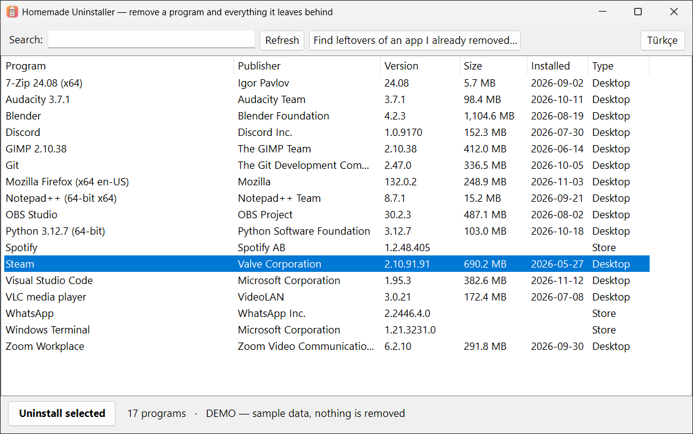
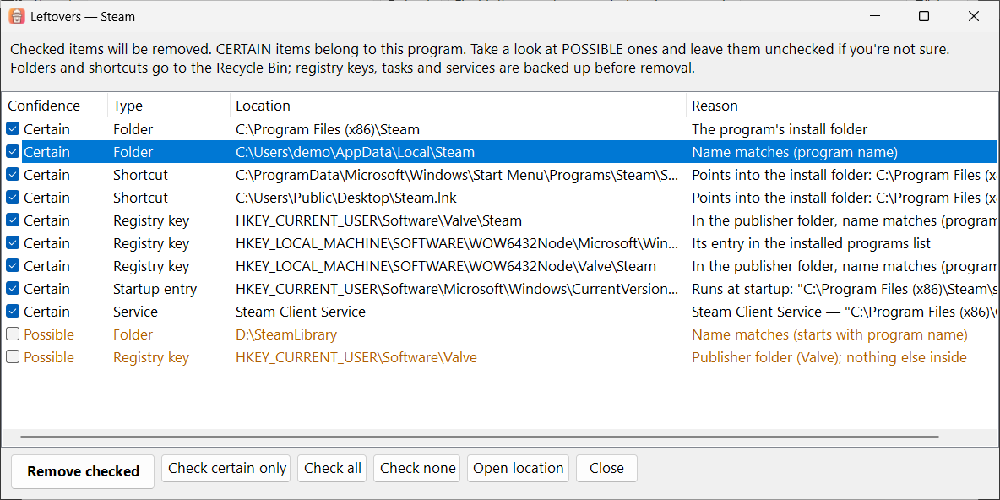

<p align="center">
  
</p>

<h1 align="center">Homemade Uninstaller</h1>

<p align="center">
  A small, ad-free Windows uninstaller that removes a program <b>and</b> everything it leaves behind.<br>
  One PowerShell file. No installer, no telemetry, no network access, no "please donate" pop-ups.
</p>

<p align="center">
  <br><br>
  
</p>

<p align="center"><sub>Screenshots use demo mode (<code>-Demo</code>) with sample data. Türkçe arayüz: <a href="screenshots/main-tr.png">ana pencere</a>, <a href="screenshots/leftovers-tr.png">geride kalanlar</a>.</sub></p>

---

## Why

Third-party uninstallers tend to be either bloated or nagging. I wanted something minimal that I can read end-to-end
and trust: run the app's own uninstaller, then show me exactly what's left on disk and in the registry, and let me decide.

## Features

- **Lists installed apps:** classic desktop programs (HKLM / HKCU / WOW6432Node uninstall keys) and Microsoft Store apps.
  Search and sort by name, publisher, size or install date.
- **Runs the official uninstaller first.** It waits for it to finish, including NSIS and Inno Setup uninstallers that
  re-spawn themselves from `%TEMP%`. MSI products are removed with `msiexec /X{GUID}`.
- **Leftover scan** across:
  - install folders, `Program Files`, `ProgramData`, `AppData` (Roaming / Local / LocalLow), Start Menu
  - registry keys under `HKCU\Software`, `HKLM\SOFTWARE` (+ WOW6432Node), and the stale uninstall entry
  - startup (`Run` / `RunOnce`) entries, scheduled tasks and services that point into the install folder
  - Start Menu, desktop and taskbar shortcuts
- **Confidence levels.** Each finding is either **Certain** (pre-checked) or **Possible** (unchecked, highlighted),
  and comes with the reason it was matched.
- **Search for an app you already removed.** Type its name and the tool looks for leftovers from programs you
  uninstalled earlier with other tools.
- **English and Turkish UI.** The language follows your Windows region on first run. Switch it with the button
  in the top-right corner, and the choice is remembered in `ayarlar.json`.
- **Readable Store app names.** `ms-resource:` display names and publishers are resolved from each package with
  `SHLoadIndirectString`, so you see "Windows Calculator / Microsoft Corporation" rather than a raw package ID.

## Safety

The tool is built around being hard to misuse:

| Guard | What it does |
|---|---|
| Recycle Bin | Files, folders and shortcuts go to the Recycle Bin and are never deleted permanently. |
| Backups | Registry keys, startup entries and services are exported with `reg export`, and scheduled tasks as XML, before removal. If the backup fails, the item is **not** deleted. |
| Protected paths | Drive roots, `%WINDIR%`, `Program Files` / `AppData` roots, user folders (Desktop, Documents, Downloads, OneDrive…), `WindowsApps`, and any folder that *contains* one of these are never touched. |
| Other apps | A folder is never suggested if another installed program lives in it. |
| Generic names | Words like `microsoft`, `update`, `common` or `launcher` never count as a match on their own. Matches in your user and Documents folders are always "Possible". |
| Dry run | `-Deneme` scans and prints the results without opening a window or deleting anything. |

## Usage

Requires Windows 10/11 and Windows PowerShell 5.1 (built in).

```powershell
# start the GUI (asks for administrator rights)
powershell -NoProfile -ExecutionPolicy Bypass -File .\Kaldir.ps1

# dry run: list what would be found for an app, deletes nothing, no admin needed
powershell -NoProfile -ExecutionPolicy Bypass -File .\Kaldir.ps1 -Deneme -DenemeAd "Discord"

# demo: the full GUI with sample data, nothing is read from or removed on your PC
powershell -NoProfile -ExecutionPolicy Bypass -File .\Kaldir.ps1 -Demo -Dil en
```

To get a desktop shortcut, create one that targets `powershell.exe` with the arguments
`-NoProfile -ExecutionPolicy Bypass -WindowStyle Hidden -File "<path>\Kaldir.ps1"` and use `homemade.ico` as its icon.

The icon is drawn in code with System.Drawing (`ikon-olustur.ps1`) and written as a multi-size `.ico` (16–256 px, PNG-compressed).

> The code identifiers and comments are in Turkish. *Kaldır* means "uninstall", *Kesin* means "certain" and *Muhtemel* means "possible".

## How matching works (short version)

1. Build keywords from the display name (with version numbers, architecture tags and the publisher prefix stripped),
   the uninstall key name, and the executable name.
2. Use the install location as a *trusted path* only if its folder name matches those keywords. Startup entries,
   tasks, services and shortcuts that point into a trusted path are **Certain**.
3. Compare the folder and registry key names under the known roots. An exact match is **Certain**, and a
   prefix or single-word match is **Possible**. A publisher folder such as `Vendor\` is suggested only when it would
   otherwise be empty.
4. Collapse nested results and sort them by confidence and type.

## License

[MIT](LICENSE)
